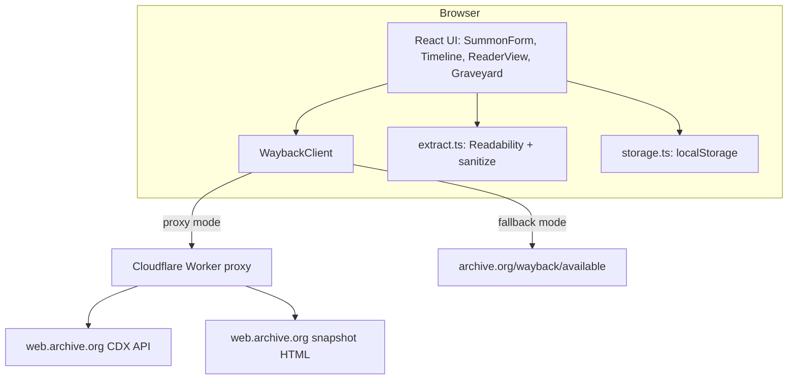
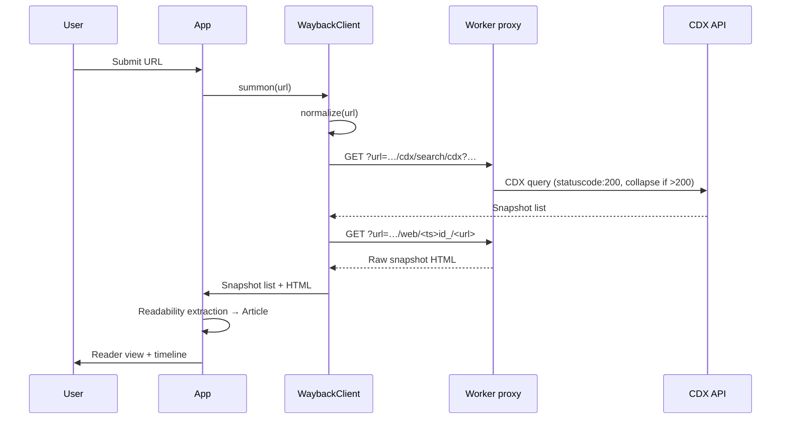
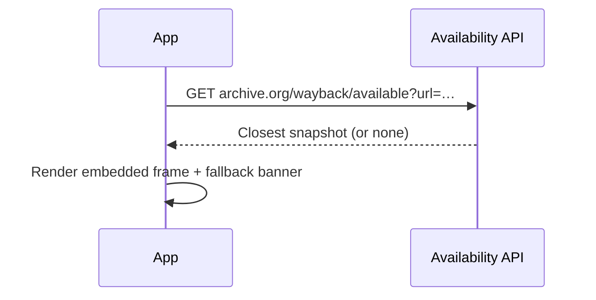

# Design: Séance

## Architecture overview

Séance is a static single-page app (Vite + React + TypeScript) plus one
Cloudflare Worker that proxies Wayback Machine traffic. There is no
application server, no database, and no account system.



### Why a proxy (verified, not assumed)

Checked with curl on 22 Nov 2026: the CDX API, raw snapshot responses, and
the timemap endpoint send **no** `Access-Control-Allow-Origin` header, and
CDX answers `OPTIONS` with 405. A browser app cannot call them. The
Availability API **does** send `Access-Control-Allow-Origin: *`, so the
browser can ask it directly — but it returns only the single closest
snapshot. Hence: proxy for the full experience, Availability API + embedded
frame as the fallback. See `README.md` for the evidence table.

## Component design

| Component | Responsibility |
| --- | --- |
| `App` | Owns the session state machine (`idle → summoning → reading → error`), renders the shell, wires hooks to components. |
| `SummonForm` | URL input + submit. Validates client-side, shows inline errors, disables while summoning. |
| `Timeline` | Year/month-grouped snapshot list. Selects a snapshot, shows per-entry errors. |
| `ReaderView` | Renders the sanitized article: title, byline/date, content blocks, images. Houses the export + summary actions. |
| `Graveyard` | Local history list (newest first), one-click re-summon, remove entry. |
| `StatusBanner` | Loading stages, errors, and the fallback-mode notice (aria-live). |

State lives in `App` via two hooks: `useWayback` (summon lifecycle,
snapshot list, current article) and `useGraveyard` (history CRUD).

## Data model

```typescript
// wayback.ts
type Snapshot = {
  timestamp: string; // 14-digit UTC "YYYYMMDDHHMMSS"
  originalUrl: string;
  statusCode: number;
};

type WaybackErrorKind =
  | "invalid-url"
  | "no-snapshots"
  | "proxy-down"
  | "snapshot-too-large"
  | "extraction-failed"
  | "network";

class WaybackError extends Error {
  kind: WaybackErrorKind;
}

// extract.ts — sanitized content model; never raw HTML strings.
type ContentBlock =
  | { type: "heading"; level: 1 | 2 | 3; text: string }
  | { type: "paragraph"; text: string }
  | { type: "quote"; text: string }
  | { type: "list"; ordered: boolean; items: string[] }
  | { type: "image"; src: string; alt: string }
  | { type: "code"; text: string };

type Article = {
  title: string;
  byline: string | null;
  publishedAt: string | null; // ISO date when the page declares one
  blocks: ContentBlock[];
  snapshot: Snapshot;
};

// storage.ts
type GraveyardEntry = {
  url: string;
  timestamp: string;
  title: string;
  resurrectedAt: string; // ISO
};
```

## Key flows

### Summon (proxy mode)



### Fallback mode



## Module design (`src/lib/`)

- **`url.ts`** — `normalizeUrl(input: string): string` (throws
  `WaybackError("invalid-url")`), `isHttpUrl`, tracking-parameter stripping.
  Pure, property-tested.
- **`time.ts`** — `parseTimestamp(t: string): Date` (strict 14-digit
  validation), `formatTimestamp(d: Date): string`,
  `formatDisplay(t: string): string` ("22 Nov 2026, 03:09 UTC").
  Pure, property-tested.
- **`wayback.ts`** — `WaybackClient` class constructed with
  `{ proxyUrl: string | null }`. Methods: `listSnapshots(url)` (CDX via
  proxy, with monthly collapse over 200 rows), `closestSnapshot(url)`
  (Availability API, direct), `fetchSnapshot(snapshot)` (raw HTML via
  proxy, 5 MB guard). `parseCdxRows(json)` is a pure, property-tested
  function. All fetches use `AbortSignal.timeout(20_000)`.
- **`extract.ts`** — `extractArticle(html: string, snapshot: Snapshot):
  Article`. Parses with DOMParser, runs Readability, rewrites relative and
  root-relative image/link URLs to `https://web.archive.org/web/<ts>im_/…`
  (images) or the archived page URL, then converts the result into the
  `ContentBlock[]` model, dropping scripts, styles, forms, and iframes.
- **`export.ts`** — `toMarkdown(article): string`,
  `toStandaloneHtml(article): string`, `download(filename, content, mime)`.
- **`storage.ts`** — `loadGraveyard()`, `addToGraveyard(entry)`,
  `removeFromGraveyard(url)`, `loadApiKey()` / `saveApiKey()` — all
  try/catch-guarded for unavailable localStorage.

## Error handling

| Situation | `WaybackError.kind` | UI |
| --- | --- | --- |
| Bad URL input | `invalid-url` | Inline form error, no network call |
| CDX returns zero rows | `no-snapshots` | Empty state + "try the bare domain" hint |
| Proxy unreachable / 5xx | `proxy-down` | Automatic fallback to Availability API + banner |
| Snapshot body > 5 MB | `snapshot-too-large` | Error state + link to web.archive.org |
| Readability finds nothing | `extraction-failed` | Raw-text fallback or link-out state |
| Network failure | `network` | Retry button + error state |

## Testing strategy

- **Unit** — every `src/lib/` module; fixtures for CDX JSON and snapshot
  HTML in `src/lib/__fixtures__/`. Component tests for `SummonForm` and
  `ReaderView` with user-visible queries.
- **Property-based (fast-check)** — URL normalization (idempotence,
  round-trip, tracking-param removal), timestamp parse/format round-trip and
  ordering, CDX row parsing (header-row skip, column tolerance). 200 runs per
  property. See `.kiro/steering/testing-standards.md`.
- **Note:** Kiro's built-in Correctness (PBT) feature is IDE-only per the
  official docs capability table, so PBT is implemented with the fast-check
  library rather than the built-in feature.
- **Manual verification** — after `npm run build`, run the production build
  against the deployed proxy with three known-dead URLs (see tasks.md T15):
  `vine.co`, `geocities.com`, and one dead blog URL. Confirm summon →
  timeline → read → export end-to-end.

## Deployment

- **App:** GitHub Actions (`.github/workflows/deploy.yml`) runs tests,
  builds, and deploys `dist/` to GitHub Pages on every push to `main`.
  `VITE_WAYBACK_PROXY_URL` comes from the repository variable
  `WAYBACK_PROXY_URL`.
- **Proxy:** `npm run worker:deploy` (Cloudflare free tier). The worker URL
  is then stored as the `WAYBACK_PROXY_URL` repo variable and in
  `.env.local` for local development.

## Security and privacy

- Archived pages are never executed: no scripts, no iframes with scripts,
  no `dangerouslySetInnerHTML` of archive content. The reader renders only
  the sanitized `ContentBlock[]` model.
- The proxy allow-lists two hosts, GET only, and caps responses at 5 MB —
  it cannot be used as an open proxy.
- No analytics, no cookies, no accounts. localStorage holds only the
  Graveyard and the optional user-provided OpenRouter key.

## Decisions

| Decision | Rationale |
| --- | --- |
| Vite + React + TS (no framework) | Smallest credible stack for a polished SPA; no SSR needed. |
| GitHub Pages + Cloudflare Worker (not a single-platform deploy) | Pages hosting is proven in this workspace; the Worker is the smallest possible proxy (one file, free tier). |
| Readability over a custom extractor | Battle-tested article extraction; the custom part is the sanitizer + block model. |
| Sanitized block model over raw HTML render | Judge-facing safety story: dead pages cannot run code in the app. |
| Availability API as fallback (not a public CORS proxy) | First-party, CORS-open, maintained by the Internet Archive; public CORS proxies are unreliable and untrusted. |
| fast-check PBT over Kiro's built-in Correctness | Correctness is IDE-only; the CLI build needs library PBT. |
