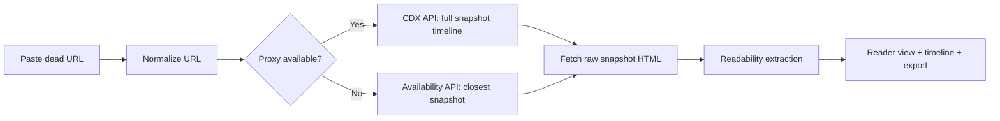

# Séance — Raise Dead Links

> Paste a dead link. Watch it come back to life.

Séance resurrects dead web pages (link rot). Give it a URL that returns 404 —
or whose domain is long gone — and it finds the page's archived snapshots in the
[Wayback Machine](https://web.archive.org/), reconstructs a clean, readable
version of the page, and lets you read it, browse its snapshot timeline, and
export it as Markdown or HTML.

Built for **Kiroween 2026** (category: **Resurrection**) — a Halloween-themed
hackathon by [Kiro](https://kiro.dev) on Devpost. The project is built
spec-first with Kiro: see [`.kiro/`](#built-with-kiro).

## How it works



1. **Summon** — paste any URL. Séance normalizes it (scheme, trailing slash,
   `www`, tracking parameters) and asks the Wayback Machine for snapshots.
2. **Timeline** — pick any snapshot from the page's history, grouped by year
   and month.
3. **Read** — the archived HTML is reconstructed into a clean reader view
   (title, content, images rewritten to their archived copies).
4. **Export** — download the resurrected page as Markdown or standalone HTML.
5. **Graveyard** — every resurrection is kept in a local history so you can
   revisit past séances. No account, no server-side storage.

No API key is needed for the core flow. An optional AI summary (user-provided
OpenRouter key, stored only in the browser) can summarize a resurrected page —
it is never required.

## Architecture

Séance is a client-side single-page app (Vite + React + TypeScript) hosted on
GitHub Pages, plus one tiny Cloudflare Worker that acts as a CORS proxy for the
Wayback Machine.

**Why a proxy?** Verified 22 Nov 2026 from this machine:

| Wayback endpoint | Browser-callable? | Evidence |
| --- | --- | --- |
| CDX search API (`web.archive.org/cdx/...`) | ❌ No `Access-Control-Allow-Origin`; `OPTIONS` → 405 | curl header check |
| Raw snapshot fetch (`web.archive.org/web/<ts>id_/...`) | ❌ No `Access-Control-Allow-Origin` | curl header check |
| Timemap (`web.archive.org/web/timemap/...`) | ❌ No `Access-Control-Allow-Origin` | curl header check |
| Availability API (`archive.org/wayback/available`) | ✅ `Access-Control-Allow-Origin: *` | curl header check |

So the browser can ask "is there a snapshot?" directly, but it cannot list
snapshots or read snapshot HTML without a proxy. The Worker (`worker/proxy.ts`,
~60 lines) forwards only `GET` requests to `web.archive.org` and `archive.org`,
adds `Access-Control-Allow-Origin: *`, and caps responses at 5 MB. It needs no
key and no account on the reader's side.

**Fallback:** if the proxy is unreachable, Séance degrades gracefully — it uses
the Availability API directly and shows the closest snapshot in an embedded
frame, with a clear note that the reader view needs the proxy.

## Quick start

```bash
npm install
npm run dev        # http://localhost:5173
```

| Script | What it does |
| --- | --- |
| `npm run dev` | Vite dev server |
| `npm run build` | Type-check + production build |
| `npm run preview` | Serve the production build |
| `npm test` | Vitest test suite (unit + property-based) |
| `npm run typecheck` | `tsc --noEmit` |
| `npm run lint` | ESLint |

### Proxy

```bash
npm run worker:dev      # local worker on http://localhost:8787
npm run worker:deploy   # deploy to Cloudflare (free tier, no card)
```

Set the deployed proxy URL for the app with `VITE_WAYBACK_PROXY_URL`
(see `.env.example` — copy it to `.env.local`). Without it, the app runs in
fallback mode.

## Built with Kiro

This project is developed spec-first with Kiro CLI v3. Everything Kiro needs
lives in [`.kiro/`](.kiro/):

| Piece | What it is |
| --- | --- |
| `.kiro/specs/seance/` | Feature spec: `requirements.md` (EARS), `design.md`, `tasks.md` |
| `.kiro/steering/` | Persistent context: `product.md`, `tech.md`, `structure.md`, `testing-standards.md` |
| `.kiro/hooks/` | Automation: typecheck + lint on save, test suite after each spec task |
| `.kiro/settings/mcp.json` | MCP servers: `fetch` (web fetch) and `wayback` (custom Wayback tools) |
| `.kiro/agents/reviewer.md` | Read-only reviewer agent (haiku model, test/typecheck shell only) |

Property-based tests (Vitest + fast-check) cover URL normalization, snapshot
timestamp parsing/formatting, and CDX row parsing. Note: Kiro's built-in
Correctness (PBT) feature is IDE-only, so PBT here is implemented with the
fast-check library instead.

## Deployment

Pushing to `main` builds the app and deploys it to GitHub Pages via
[`.github/workflows/deploy.yml`](.github/workflows/deploy.yml). The Worker is
deployed separately with `npm run worker:deploy`.

## License

MIT — see [LICENSE](LICENSE).
